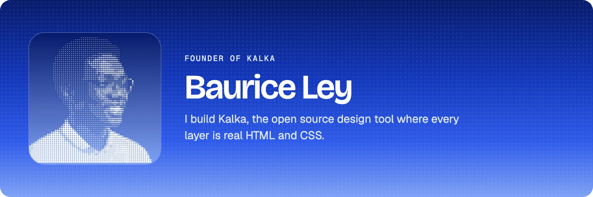
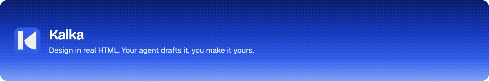
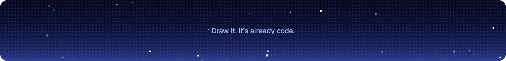

  <a href="https://kalka.design">
    <picture>
      <source media="(prefers-color-scheme: dark)" srcset="assets/banner-dark.webp">
      
    </picture>
  </a>

<table>
  <tr>
    <td width="60%" valign="top">
      <a href="https://github.com/leyscore/kalka">
        <picture>
          <source media="(prefers-color-scheme: dark)" srcset="assets/kalka-dark.webp">
          
        </picture>
      </a>
       <a href="https://github.com/leyscore/kalka">leyscore/kalka</a> &nbsp; <a href="https://kalka.design">kalka.design</a> &nbsp; <a href="https://kalka.design/#download">Download</a>
    </td>
    <td width="40%" valign="top">
      <strong>Building in public</strong> 
      Every feature ships with a short video on X, good or bad.  
      <a href="https://x.com/bedleybuilds">@bedleybuilds</a>
    </td>
  </tr>
</table>

### What I work on

- **Kalka**: a desktop and web design editor whose canvas is the browser itself, with agents over MCP and a self-hosted server for teams ([kalka.design](https://kalka.design), [leyscore/kalka](https://github.com/leyscore/kalka)).
- **Kalka Ley**: a model that tells careful design from AI slop, trained by the votes of **Slop or not** ([kalka.design/bench](https://kalka.design/bench)).
- **Leiho**: the visual content editor for headless WordPress. Next.js and Astro sites become editable inside WordPress, while the design stays in code ([leiho.dev](https://leiho.dev)).
- **Pixelers**: my studio, building websites for clients, designed in Kalka and edited with Leiho ([pixelers.fr](https://pixelers.fr)).

### Reach me

  
  
  
  
  

  

